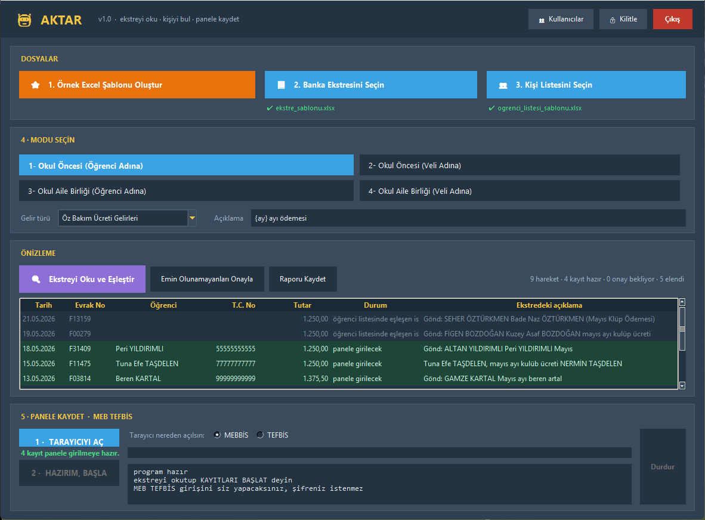

<div align="center">

# Aktar

**Reads a bank statement, works out who paid what, and enters the records into a web panel for you.**

[](https://github.com/ardazeybek-dev/aktar/actions/workflows/ci.yml)
[](https://www.python.org/)
[](https://playwright.dev/python/)
[](LICENSE)
[](https://github.com/ardazeybek-dev/aktar/releases)
[](#testing)

[Türkçe README](README.tr.md) · [Download for Windows](https://github.com/ardazeybek-dev/aktar/releases)

</div>



> **Note on language:** the source code, the UI and the inline comments are in
> Turkish. The problem is Turkish too — Turkish name matching, Turkish number
> formats, Turkish government panels. This README is in English so the approach
> and the architecture can be read by anyone.

---

## The problem

Anyone who has to type a hundred-odd bank transfers into a web panel by hand
every month: a school, an association, a building management office, a small
accounting practice.

The case this was built for: a preschool entering parents' monthly fees into a
government panel. 80–130 records a month, 9–10 clicks each. About two full
working days.

The hard part was never the clicking. It was **understanding the statement**.
Parents write whatever they like in the transfer description:

```
Gönd: SEHER ÖZTÜRKMEN Bade Naz ÖZTÜRKMEN (Mayıs Klüp Ödemesi) 0015-...FAST işlemi
Gönd: GAMZE KARTAL Mayıs ayı beren artal 0067-Yapı ve Kredi
Tuna Efe TAŞDELEN, mayıs ayı kulüb ücreti NERMİN TAŞDELEN Ziraat Mobil Havale
```

The child's name is sometimes first, sometimes last, sometimes absent entirely —
only the mother's name is there. A surname is missing its first letter
(`beren artal` → **Beren KARTAL**). The word for "club" is spelled four different
ways. Four separate families share a surname and must not be confused with one
another. Mixed in are payments that are *not* fees at all — donations, canteen
income, rent, interest — which must never be entered.

## What it does

Three stages, each meaningful on its own:

| Stage | What it does | Source |
|---|---|---|
| **Read** | Parses the statement: finds the header row itself, understands Turkish number format (`-22.936,29`), discards the bank's letterhead and footnotes | [`src/ekstre.py`](src/ekstre.py) |
| **Match** | Extracts a person from free text, fuzzy-matches against a roster, and rules every row **certain / uncertain / none** | [`src/eslestir.py`](src/eslestir.py) |
| **Enter** | Drives the target panel — everything panel-specific comes from a *recipe* file | [`src/panel.py`](src/panel.py) · [`src/tarifler/`](src/tarifler/) |

An uncertain match is **never** entered on its own. It is handed back to the user.

---

## Technical highlights

### 1. Selectors that don't break when the panel changes

The panels this targets are mostly legacy ASP.NET WebForms. Ids like
`ctl00$ContentPlaceHolder1$txtEvrakNo` shift between releases and the automation
dies silently. Aktar locates fields **by the label text on screen** instead — the
input next to the cell that reads "Evrak No :":

```python
xpath=//*[self::td or self::label or self::span or self::div]
      [not(*)][string-length(normalize-space(.)) < 40]
      [contains(normalize-space(.), 'Evrak No')]
      /following::input[1]
```

The `[not(*)]` predicate was added after a real failure and is the load-bearing
part: without it, a `<div>` wrapping the entire page also *contains* the text
"Evrak No", matches, and yields the wrong input. Requiring a leaf node fixes it;
`string-length < 40` guards the same problem from a second angle.

A related trap: the screen shows both "Toplam Tutar" (total) and, on the detail
row, "Tutar" (amount). Searching for "Tutar" matched both. Each recipe therefore
carries a per-field **exclusion list**.

### 2. Turkish fuzzy name matching

A Turkish-specific normalisation layer on top of `rapidfuzz`: folding
`ğ/ü/ş/ı/ö/ç`, stripping month names and banking noise (`gönd`, `fast işlemi`,
`havale`, `kulüp`, `aidat`), then token-based scoring.

The decision uses three thresholds:

```python
ESIK_KESIN = 88   # above this, accept automatically
ESIK_SUPHE = 72   # above this, ask the user; below, no match
FARK_ESIGI = 6    # if the top two candidates are closer than this: uncertain
```

The last one matters most. Even at a score of 91, if the runner-up sits at 88 the
program refuses to decide — because when two families share a surname, a high
score does not mean *correct*. Precision is worth more than coverage here: a
wrongly attributed payment is far more expensive than one the user has to
confirm by hand.

Real cases it handles: `TUNCAL ↔ TUNÇEL` (vowel error), `beren artal ↔ Beren
KARTAL` (dropped initial), two siblings under one parent (→ uncertain, user
picks), a name that matches on a negative amount (→ uncertain, the money left
the account).

> **A known limitation:** month names are treated as noise and stripped. When a
> child in the test data was named "Nisan" (April), the name was stripped and the
> match fell through to uncertain. Turkish given names that are also month names
> — Nisan, Şubat — hit this filter.

### 3. One failed row doesn't stop the run

If the panel errors on record 47 of 100, losing the remaining 53 is not
acceptable. Every record runs in its own `try`; the error is caught, the form is
reset, the loop moves to the next row. At the end the user gets a report of which
rows failed and why.

Detecting the failure turned out to be subtler than expected. The panel's red
warning text arrives in mixed case. Matching against lowercase patterns meant
"Zorunlu Alanlar Boş Bırakılamaz" *was never seen* — and the program counted the
record as saved. Silent data loss, the worst kind of bug in this class of tool.

### 4. The same record is never entered twice

Each record is fingerprinted from `(date, document no, national id, cents)` and
stored. If the same statement is processed again, those rows are marked as
already entered and skipped.

### 5. No credentials in the program

Aktar never stores, requests or transmits a credential. It opens the browser,
**the user signs in themselves**, and the engine simply waits for the session to
be ready. It then enters the user's own data, under the user's own authority, in
the user's own session.

The program's own launch password is not written to disk either — only a
PBKDF2-SHA256 digest (200,000 rounds) is kept. There is no licence server and no
network access is required.

### 6. It doesn't ship a 150 MB browser

Rather than downloading Playwright's bundled Chromium, it attaches to the Chrome
already installed on the machine, falling back to Edge. It does so by launching a
normal Chrome and connecting over CDP, so the user's own profile, session and
extensions apply — and the distributed package stays portable.

### 7. It recovers Excel files openpyxl refuses to open

Files exported from banks, or round-tripped through Google Sheets, LibreOffice or
older Excel, often carry fill and font definitions openpyxl doesn't recognise.
The file simply won't open:

```
TypeError: expected <class 'openpyxl.styles.fills.Fill'>
```

The data is intact — only the cell's *appearance* is malformed.
[`src/excel_ac.py`](src/excel_ac.py) retries on a temporary copy in which only
the visual style blocks (`fills`, `fonts`, `borders`) are replaced with defaults.

The subtle part: number formats (`numFmts`) and the cell-style mapping (`cellXfs`)
are **never** stripped. In Excel a date *is* a number; what makes it a date is its
number format. Clearing that block too would have made every date read back as
`45900` — the file would open, the program would run, and the output would be
quietly wrong. Block *counts* are preserved as well, so `fillId` / `fontId`
references inside `cellXfs` stay valid.

The test suite verifies the repair: row counts, dates still being real date
objects, amounts and national ids are all compared one by one.

---

## Architecture: the engine doesn't know the panel

`panel.py` is a generic driver. Everything specific to a target — addresses,
field labels, button captions, screen flow — lives in a **recipe**.

```
src/
├── panel.py            generic engine: find-by-label, waits, error isolation, the loop
├── tarifler/
│   ├── temel.py        the contract a recipe fulfils
│   └── tefbis.py       worked example: a Turkish MoNE revenue-entry panel
├── ekstre.py           statement reader
├── eslestir.py         matcher
├── excel_ac.py         Excel recovery
└── arayuz.py           desktop UI — reads its options from the recipe
```

A minimal recipe:

```python
from panel import tr_tutar
from tarifler.temel import Tarif

class MyPanel(Tarif):
    ad = "Example Panel"
    giris_adresleri = {"main": "https://example.gov.tr/"}
    etiketler = {"evrak_no": ("Document No", "Document No :"),
                 "tutar": ("Amount", "Amount :")}
    haric_metinler = {"tutar": ("Total",)}
    butonlar = {"kaydet": ("Save",)}

    def kayit_gir(self, motor, kayit):
        motor.zorunlu_alan("evrak_no").fill(str(kayit["evrak_no"]))
        motor.zorunlu_alan("tutar").fill(tr_tutar(kayit["tutar"]))
        motor.dugme("kaydet").click()
```

Drop it in `src/tarifler/` and add it to the `TARIFLER` list. The desktop UI
reads its dropdowns, mode buttons and login addresses from the recipe — adding a
panel means touching no UI code at all.

The full worked example is [`src/tarifler/tefbis.py`](src/tarifler/tefbis.py)
(354 lines), which drives the revenue-entry screen of TEFBİS, a Turkish Ministry
of National Education system. It is included as a *reference implementation*, not
as the product.

**Vocabulary**, since the code is Turkish: `tarif` = recipe, `panel` = panel,
`ekstre` = bank statement, `eslestir` = match, `kayit` = record, `motor` =
engine, `tutar` = amount, `dugme` = button, `alan` = field.

---

## Installation

**Windows, ready to run:** grab the zip from
[Releases](https://github.com/ardazeybek-dev/aktar/releases), extract the whole
folder and run `Aktar.exe`. No Python required. Chrome or Edge must be installed.

**From source:**

```bash
git clone https://github.com/ardazeybek-dev/aktar.git
cd aktar
pip install -r requirements.txt
python -m playwright install chromium   # only if neither Chrome nor Edge is present
python aktar.py
```

Python 3.10+. Runtime dependencies: `openpyxl`, `rapidfuzz`, `playwright`.

To build the executable yourself: `pip install -r requirements-dev.txt` then
`python paket_yap.py` (add `tek` for a single-file build).

## Testing

Core logic — no browser, no display, so these run on every OS and Python
version in CI:

```bash
python testler/testler.py             # 57 tests — reading, matching, duplicate guard
python testler/dayaniklilik_testi.py  # 39 tests — malformed input, varied bank layouts
python testler/bozuk_excel_testi.py   # 17 tests — corrupted Excel recovery
```

The engine, driven by a real browser against the mock panel in
`demo/sahte_tefbis/` — which carries the same labels and the same
popup-and-return flow as the real thing. This is what proves the parts the
unit tests cannot: that a field is found from its on-screen label, that
`Tutar` is filled rather than `Toplam Tutar`, that the run comes back to the
main page after the selection popup, and that an unknown record is skipped
without stopping the loop.

```bash
python testler/panel_prova.py         # 14 checks — headless, no real panel touched
```

The desktop UI, opened for real. Three of the checks in the end-to-end run read
the **rendered** colour of a button off the screen rather than trusting
`cget('bg')` — which lies for a `Radiobutton` with `indicatoron=False`, and once
hid a selected button that was actually rendering white. Those three need Pillow
and a session with a screen; without either they skip and the other 42 still run,
so CI reports 42:

```bash
python testler/arayuz_akis_testi.py   # 16 checks — button states, two-stage flow
python testler/uctan_uca_test.py      # 45 checks — password → template → match → confirm → report
```

One more runs locally but is deliberately kept out of CI, because it opens a
**visible** Chrome and attaches to it over CDP — the thing it verifies is that
the browser looks like an ordinary one, which a headless runner cannot honestly
measure:

```bash
python testler/tarayici_testi.py      # 12 checks — CDP attach, no automation banner
```

To try the whole pipeline end to end without touching any panel:

```bash
python demo/test_verisi_uret.py   # generates a fictional statement + roster
python demo/demo_calistir.py      # reads, matches, writes an HTML report
```

Sample result: 41 transactions → 20 ready to enter, 3 awaiting confirmation,
18 correctly rejected (bank fees, tax, payroll, donation, rent). No mismatches.

---

## Data and responsibility

- **Every name, national id and bank transaction in this repository is
  fictional.** No real personal data is present. The test data is generated by
  [`demo/test_verisi_uret.py`](demo/test_verisi_uret.py); the national ids satisfy
  the Turkish MERNIS checksum but belong to no one.
- Aktar sends nothing anywhere. Neither what it reads nor what it writes leaves
  the machine. There is no telemetry and no licence check.
- It speeds up a user entering **their own data, in their own session, under
  their own authority**. It does not obtain access to any system the user is not
  already entitled to use.
- Before using it against an institutional panel, checking that organisation's
  terms of use is the user's responsibility.

## License

MIT — Seyid Arda Zeybek
