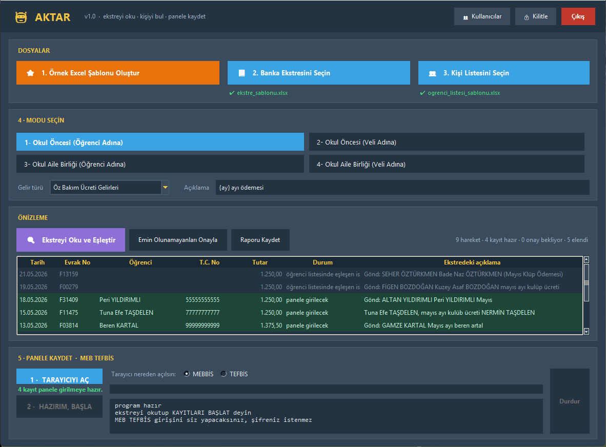

<div align="center">

# Aktar

[](https://github.com/ardazeybek-dev/aktar/actions/workflows/ci.yml)
[](https://www.python.org/)
[](https://playwright.dev/python/)
[](LICENSE)
[](#testler)

[English README](README.md) · [Windows için indir](https://github.com/ardazeybek-dev/aktar/releases)

</div>

**Banka ekstresini okur, ödemeleri kişilerle eşleştirir, web paneline sizin yerinize girer.**

Ayda 100 küsur havaleyi tek tek bir panele elle girmek zorunda kalan herkes için:
okul, dernek, apartman yönetimi, kurs, küçük muhasebe bürosu. Aktar ekstreyi okur,
"kim ne ödemiş"i çözer, sonra kayıtları hedef panele **sizin oturumunuzda** girer.



---

## Sorun

Bir anaokulunun aylık işi şöyleydi: bankadan ekstre indir, Excel'de aç, her satırın
kime ait olduğunu bul, sonra devletin panelinde her çocuk için 9-10 tıklama yap.
Ayda 80-130 kayıt. Yaklaşık iki tam iş günü.

Zor kısım tıklamak değil, **ekstreyi anlamak**. Veliler açıklamaya ne isterlerse
onu yazıyor:

```
Gönd: SEHER ÖZTÜRKMEN Bade Naz ÖZTÜRKMEN (Mayıs Klüp Ödemesi) 0015-...FAST işlemi
Gönd: GAMZE KARTAL Mayıs ayı beren artal 0067-Yapı ve Kredi
Tuna Efe TAŞDELEN, mayıs ayı kulüb ücreti NERMİN TAŞDELEN Ziraat Mobil Havale
```

Çocuğun adı bazen başta, bazen sonda, bazen hiç yok — sadece annenin adı var.
Soyadın baş harfi düşmüş (`beren artal` → **Beren KARTAL**). `klup / klüp / kulüb /
klub`, `aidat / aydat`. Aynı soyadlı dört ayrı aile var ve karıştırılmamalı.
Arada aidat olmayan gelirler (bağış, kantin, kira, faiz) var, onlar girilmemeli.

## Çözüm

Üç aşama, üçü de ayrı ve tek başına anlamlı:

| Aşama | Ne yapar | Dosya |
|---|---|---|
| **Oku** | Ekstreyi çözer: başlık satırını kendi bulur, Türkçe sayı formatını (`-22.936,29`) anlar, banka antetini ve dipnotlarını atar | `src/ekstre.py` |
| **Eşleştir** | Serbest metinden kişiyi çıkarır, kişi listesiyle bulanık eşleştirir, her satıra **kesin / şüpheli / yok** kararı verir | `src/eslestir.py` |
| **Aktar** | Kayıtları hedef panele girer — panele özel her şey bir *tarif* dosyasından gelir | `src/panel.py` + `src/tarifler/` |

Şüpheli olan **asla** kendiliğinden girilmez; kullanıcıya sorulur.

---

## Teknik olarak ilginç kısımlar

### 1. Kırılgan CSS id'sine bağlanmayan seçici

Hedef paneller çoğunlukla eski ASP.NET WebForms. `ctl00$ContentPlaceHolder1$txtEvrakNo`
gibi id'ler sürüm değişiminde kayar ve otomasyon sessizce ölür. Aktar alanları
**ekrandaki etiket metninden** bulur — "Evrak No :" yazan hücrenin yanındaki input:

```python
xpath=//*[self::td or self::label or self::span or self::div]
      [not(*)][string-length(normalize-space(.)) < 40]
      [contains(normalize-space(.), 'Evrak No')]
      /following::input[1]
```

`[not(*)]` kısmı sonradan eklendi ve kritik: onsuz, sayfanın tamamını saran bir `div`
de "Evrak No" metnini *içerdiği* için eşleşiyor ve yanlış input bulunuyordu. Yaprak
düğüm şartı bunu çözer. `string-length < 40` de aynı işi ikinci bir açıdan yapar.

Benzer bir tuzak: ekranda hem "Toplam Tutar" hem detay satırında "Tutar" var.
Sadece "Tutar" arayınca ikisi de eşleşiyordu. Tarif başına **hariç metin** listesi
bunu çözer.

### 2. Türkçe bulanık isim eşleştirme

`rapidfuzz` üstünde Türkçeye özel bir normalizasyon katmanı: `ğ/ü/ş/ı/ö/ç`
sadeleştirme, ay adları ve banka gürültüsü (`gönd`, `fast işlemi`, `havale`,
`kulüp`, `aidat`) temizliği, sonra token bazlı skor.

Karar üç eşikle veriliyor:

```python
ESIK_KESIN = 88   # üstü otomatik kabul
ESIK_SUPHE = 72   # üstü kullanıcıya sorulur, altı eşleşmedi
FARK_ESIGI = 6    # en iyi ile ikinci aday arasındaki fark bundan azsa: şüpheli
```

Son satır en önemlisi. Skor 91 olsa bile ikinci aday 88'deyse program karar
vermez — çünkü aynı soyadlı iki aile varken yüksek skor "doğru" demek değil.

Yakalanan gerçek senaryolar: `TUNCAL ↔ TUNÇEL` (ünlü harf hatası), `beren artal ↔
Beren KARTAL` (baş harf düşmesi), aynı veliye bağlı iki kardeş (→ şüpheli, kullanıcı
seçer), eksi tutarda isim tutması (→ şüpheli, para hesaptan çıkmış).

> **Bir kenar durum:** ay adları gürültü sayılıp atılıyor. Test verisindeki bir
> çocuğun adı "Nisan" olunca adı elendi ve eşleşme şüpheliye düştü. Gerçek bir
> kısıt — ad olarak da kullanılan ay isimleri (Nisan, Şubat) bu filtreye takılır.

### 3. Bir satır patlarsa döngü durmaz

100 kaydın 47'ncisinde panel hata verirse kalan 53'ü de kaybetmek kabul edilemez.
Her kayıt kendi `try` bloğunda; hata yakalanır, form temizlenir, sıradaki satıra
geçilir. Sonunda hangi satırın neden girilemediği raporlanır.

Hata tespiti de göründüğünden ince: panelin kırmızı uyarı metni büyük/küçük harf
karışık geliyor. Küçük harfli kalıpla ararken "Zorunlu Alanlar Boş Bırakılamaz"
görülmüyordu ve program kaydı **başarılı sanıyordu** — sessiz veri kaybı.

### 4. Aynı kayıt iki kez girilmez

Her kaydın `(tarih, evrak no, TC, kuruş)` dörtlüsünden bir parmak izi üretilip
saklanıyor. Aynı ekstre ikinci kez işlenirse o satırlar `girildi` olarak
işaretlenir ve tekrar gönderilmez.

### 5. Şifre programda yok

Program hiçbir kimlik bilgisi tutmaz, sormaz, göndermez. Tarayıcı açılır,
**girişi kullanıcı kendisi yapar**, motor sadece girişin tamamlanmasını bekler.

Programın kendi açılış şifresi de diske yazılmaz — yalnızca PBKDF2-SHA256
özeti (200.000 tur) saklanır. Lisans sunucusu yoktur, internet gerekmez.

### 6. Yanında 150 MB tarayıcı taşımaz

Playwright kendi Chromium'unu indirmek yerine önce bilgisayardaki Chrome'a,
olmazsa Edge'e bağlanır. Bağlanma yolu da normal bir Chrome başlatıp CDP
üzerinden ona bağlanmak — böylece kullanıcının kendi profili, kendi oturumu,
kendi eklentileri geçerli olur.

### 7. openpyxl'in açamadığı Excel'i kurtarır

Bankadan indirilen ya da Google Sheets / LibreOffice / eski Excel'den geçmiş
dosyalarda openpyxl'in tanımadığı dolgu ve yazı tipi tanımları oluyor, dosya
hiç açılmıyor:

```
TypeError: expected <class 'openpyxl.styles.fills.Fill'>
```

Veri sağlam — bozulan sadece hücrenin **görünüşü**. `src/excel_ac.py` geçici bir
kopyada yalnızca görsel stil bloklarını (`fills`, `fonts`, `borders`) varsayılanla
değiştirip yeniden deniyor.

İnce nokta: sayı biçimleri (`numFmts`) ve hücre-stil eşlemesi (`cellXfs`) **asla**
silinmiyor. Excel'de tarih bir sayıdır; tarih olduğu sayı biçiminden anlaşılır.
O blok da temizlenseydi bütün tarihler `45900` olarak okunurdu — dosya açılırdı,
program çalışırdı, sonuç sessizce yanlış olurdu. Blok *sayıları* da korunuyor ki
`cellXfs` içindeki `fillId` / `fontId` referansları geçerli kalsın.

Testler bunu doğruluyor: onarım sonrası satır sayısı, tarihlerin gerçekten tarih
nesnesi olduğu, tutarlar ve T.C. numaraları tek tek karşılaştırılıyor.

---

## Yeni bir panel eklemek

Motor hangi panele girdiğini bilmez. Panele özel her şey bir tarif dosyasındadır:

```python
from tarifler.temel import Tarif

class BenimPanelim(Tarif):
    ad = "Örnek Panel"
    giris_adresleri = {"ana": "https://ornek.gov.tr/"}
    etiketler = {"evrak_no": ("Evrak No", "Evrak No :"),
                 "tutar": ("Tutar", "Tutar :")}
    haric_metinler = {"tutar": ("Toplam",)}
    butonlar = {"kaydet": ("Kaydet",)}

    def kayit_gir(self, motor, kayit):
        motor.zorunlu_alan("evrak_no").fill(str(kayit["evrak_no"]))
        motor.zorunlu_alan("tutar").fill(tr_tutar(kayit["tutar"]))
        motor.dugme("kaydet").click()
```

Dosyayı `src/tarifler/` altına koyup `TARIFLER` listesine ekleyin — arayüz
seçim kutularını, giriş adreslerini ve modları tariften okur, kendisi değişmez.

Tam bir örnek: [`src/tarifler/tefbis.py`](src/tarifler/tefbis.py) (MEB TEFBİS
gelir kayıt ekranı, 354 satır).

---

## Kurulum

Hazır exe: [Releases](https://github.com/ardazeybek-dev/aktar/releases) sayfasından
indirip çalıştırın — Python kurmaya gerek yok.

Kaynaktan:

```bash
git clone https://github.com/ardazeybek-dev/aktar.git
cd aktar
pip install -r requirements.txt
python -m playwright install chromium   # sistemde Chrome/Edge yoksa
python aktar.py
```

Python 3.11+. Bağımlılıklar: `openpyxl`, `rapidfuzz`, `playwright`.

## Testler

Çekirdek mantık — tarayıcı da ekran da gerekmez, bu yüzden CI'da her işletim
sistemi ve Python sürümünde koşar:

```bash
python testler/testler.py             # 57 test — okuma, eşleştirme, mükerrer koruma
python testler/dayaniklilik_testi.py  # 39 test — bozuk girdi, farklı banka düzenleri
python testler/bozuk_excel_testi.py   # 17 test — kilitli/bozuk Excel kurtarma
```

Motorun `demo/sahte_tefbis/` üzerinde gerçek tarayıcıyla provası — sahte sayfa
gerçek ekranın etiketlerini ve aynı "ayrı pencerede seç, ana sayfaya dön"
akışını taşıyor. Birim testlerin ölçemediğini bu ölçüyor: alan ekrandaki
etiketten bulunuyor mu, `Toplam Tutar` yerine `Tutar` mı doluyor, seçim
penceresinden ana sayfaya dönülüyor mu, kayıtsız T.C. döngüyü durdurmadan
atlanıyor mu.

```bash
python testler/panel_prova.py         # 14 kontrol — headless, gerçek panele girilmez
```

Masaüstü arayüzü, gerçekten açılarak. Uçtan uca koşudaki 3 kontrol, düğmenin
ekranda **görünen** rengini piksel olarak okur — `cget('bg')` güvenilir değil:
`indicatoron=False` olan `Radiobutton`'da yalan söylüyor ve bir keresinde seçili
düğme bembeyaz çıktığı halde bunu göstermemişti. Bu üçü Pillow ve ekranı olan bir
oturum ister; ikisi de yoksa atlanır ve kalan 42 kontrol yine koşar — CI'da
görülen sayı bu yüzden 42:

```bash
python testler/arayuz_akis_testi.py   # 16 kontrol — düğme durumları, iki aşamalı akış
python testler/uctan_uca_test.py      # 45 kontrol — şifre → şablon → eşleştir → onay → rapor
```

Bir tanesi yerelde çalışır ama CI'a bilerek konmadı: **görünür** bir Chrome
açıp ona CDP ile bağlanıyor — doğruladığı şey tarayıcının sıradan görünmesi,
ki bunu headless bir koşucu dürüstçe ölçemez:

```bash
python testler/tarayici_testi.py      # 12 kontrol — CDP bağlantısı, otomasyon çubuğu yok
```

Panele bağlanmadan uçtan uca denemek için:

```bash
python demo/test_verisi_uret.py   # uydurma ekstre + kişi listesi üretir
python demo/demo_calistir.py      # okur, eşleştirir, HTML rapor çıkarır
```

Örnek çıktı: 41 hareket → 20 girilecek, 3 onay bekliyor, 18 elendi (banka masrafı,
vergi, maaş, bağış, kira). Yanlış eşleşme yok.

---

## Veri ve sorumluluk

- **Test ve örnek dosyalardaki tüm isimler, T.C. numaraları ve banka hareketleri
  uydurmadır.** Gerçek kişi verisi bu depoda bulunmuyor. Test verisi
  `demo/test_verisi_uret.py` tarafından üretiliyor; T.C. numaraları MERNIS
  algoritmasına uygun ama gerçek kimseye ait değil.
- Program hiçbir veriyi dışarı göndermez. Ne okuduğu ne yazdığı bilgisayardan çıkar.
- Aktar, kullanıcının **kendi yetkisiyle, kendi oturumunda, kendi verisini** girmesini
  hızlandırır. Erişim yetkisi olmayan bir sisteme giriş sağlamaz.
- Bir kurum panelinde kullanmadan önce o kurumun kullanım şartlarını kontrol etmek
  kullanıcının sorumluluğundadır.

## Lisans

MIT — Seyid Arda Zeybek
